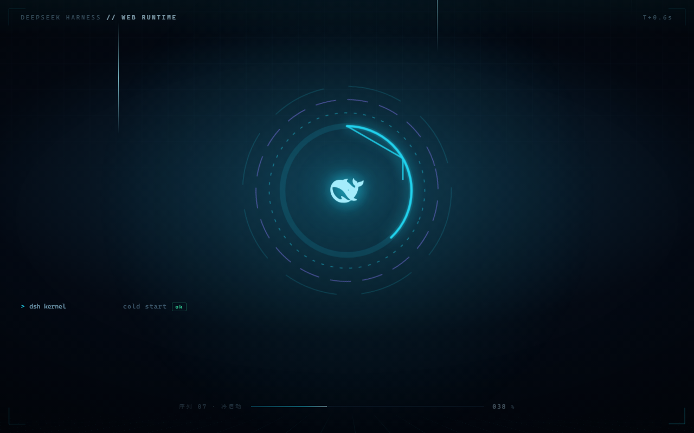
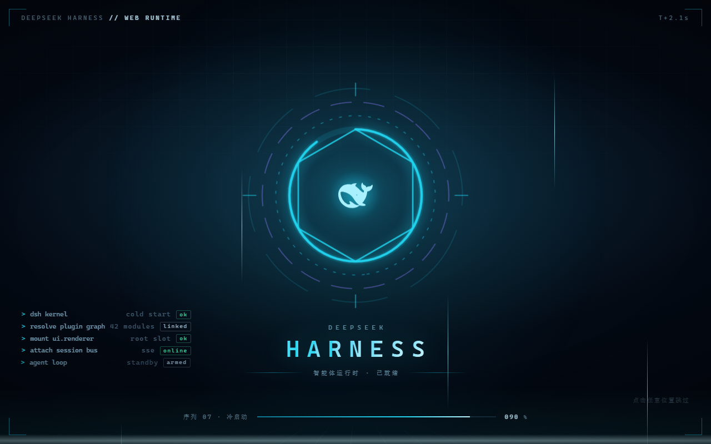

# dsh-plugin-boot-splash

A tech-flavoured **boot splash** for the [DeepSeek Harness](https://github.com/deepseek-ai/deepseek-harness) Web GUI. When the app finishes mounting, it plays a short HUD-style intro sequence over the interface (~3.8s), then wipes away. Click or press `Esc`/`Space`/`Enter` to skip.

> [中文说明](README.zh.md)




## What it looks like

| Layer | Contents |
|---|---|
| Backdrop | Deep-space gradient, a slowly drifting grid, and a perspective floor grid |
| Motion | A sweeping scanline, five vertical data streams, vignette |
| Instruments | Three counter-rotating tick rings, a progress arc, a self-drawing hexagon, the DeepSeek whale mark at the centre |
| Wordmark | `HARNESS` revealed letter by letter with a looping highlight sweep |
| Boot log | Bottom-left monospace lines typing in with `ok` / `linked` / `online` status tags |
| Progress | Bottom progress bar + `T+x.xs` timer + a padded 3-digit percentage |
| Exit | A cyan light band expands, flashes, and the whole panel scales/fades out (compressed to 190 ms on skip) |

## Behaviour

- **Plays once** per browser tab (`sessionStorage`); a normal reload does not replay, but reopening the app window does.
- **Skips** on pointer-down, `Esc`, `Space`, or `Enter`; input is intercepted while the splash is up so nothing bleeds through.
- **Reduced motion**: under `prefers-reduced-motion: reduce`, decorative animation is disabled and the sequence shortens to ~1.4 s.
- **No residue**: the component unmounts at the end and leaves no timers or listeners behind.

## Install

This is a standard DSH dual-face plugin: `lib/index.js` is the host half (an empty `apply` seat) and `lib/client.js` is the browser half, served by `dsh-client-modules` as `/plugins/<package>/client.js`.

### From a directory

```powershell
dsh plugin --profile <name> add "C:\path\to\dsh-plugin-boot-splash"
```

`dsh plugin add` installs the package as a `link:` dependency, appends it to the profile's `dsh.profile.bundles`, and the package's own `cordis.patch.yml` inserts the `ui-boot-splash` row.

### From the tarball

```powershell
npm pack                                  # produces dsh-plugin-boot-splash-1.0.0.tgz
dsh plugin --profile <name> add .\dsh-plugin-boot-splash-1.0.0.tgz
```

Or open **Plugins → Add plugin** in the Web sidebar and enter the same path.

> **Desktop profile note:** the `desktop` profile is managed exclusively by the Electron app, so `dsh plugin` refuses it. Install it with the bundled pnpm instead and append the bundle name to `dsh.profile.bundles` (see [README.zh.md](README.zh.md) for the exact commands).

### Replay / disable

```js
// force a replay (append &dshBootSplash=1 to the URL, or):
sessionStorage.removeItem('dsh.bootSplash.seen'); location.reload()

// disable permanently:
localStorage.setItem('dsh.bootSplash.disabled', '1')
```

## How it works

- **Mount point**: registers into the root-scoped `shell.overlay` list slot declared by `ui-layout`, via `ctx.slots.inject()` so it follows slot declaration order.
- **Rendering**: uses `ReactDOM.createPortal` to `document.body`, so no ancestor stacking context or `overflow` can clip it (`z-index: 9000`, above the 1100 modal layer).
- **Styles**: every rule is prefixed `dshbsp-`, injected as a `<style data-dsh-plugin="boot-splash">` through a `ctx.effect`, and removed on unload.
- **Progress clock**: reads `performance.now()` rather than the rAF frame timestamp — the frame timestamp marks the frame's start, which can precede the effect, driving the readout negative on the first frame.

## Structure

| File | Role |
|---|---|
| `package.json` | `exports["./client"]`, `dsh.client` (`platform: web`, `immediately: true`), `dsh.bundle.patch` |
| `cordis.patch.yml` | bundle patch that inserts the `ui-boot-splash` row |
| `lib/index.js` | host half — empty `apply` |
| `lib/client.js` | browser half — style injection, locale registration, the splash itself |
| `locale/{zh,en}.json` | plugin-manager title and description |
| `icon.svg` | plugin-manager icon |

## License

[MIT](LICENSE)
